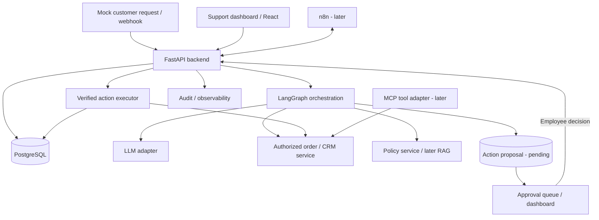
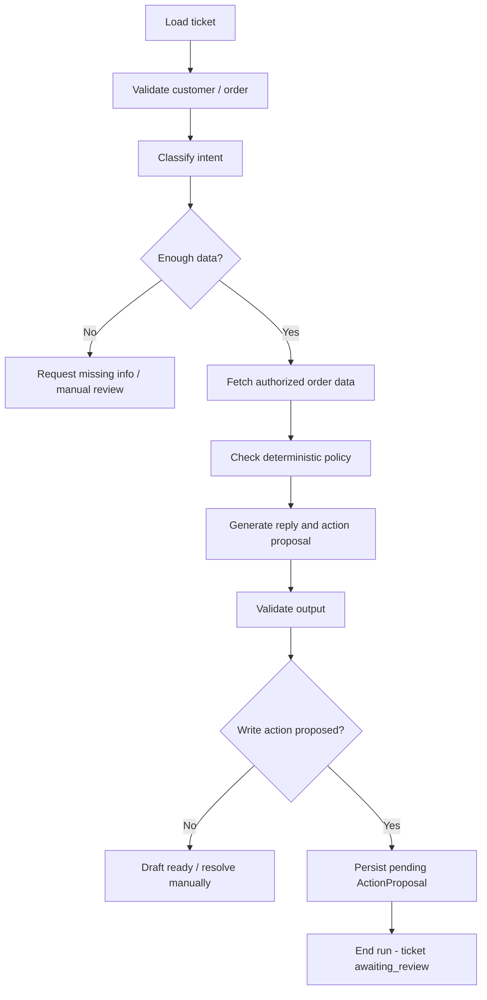

# SupportFlow AI — Uygulamalı Proje Yol Haritası

> **Proje türü:** Kurumsal müşteri destek operasyonları için AI Agent + iş akışı otomasyonu  
> **Durum:** Planlama  
> **Başlangıç:** 2026-11-02  
> **Hedef:** GitHub'da incelenebilir, yerelde çalıştırılabilir, demo ortamında uçtan uca gösterilebilir, güvenli ve testli bir portföy projesi  
> **Önerilen yaklaşım:** Önce çalışan küçük bir dikey dilim; ardından kontrollü biçimde agent, onay, RAG, MCP, n8n ve production özellikleri  
> **Revizyon (2026-11-02):** Kapsam MVP odaklı daraltıldı; auth erken fazlara alındı; analiz çalıştırma, onay/executor yerleşimi ve sync/async kararları netleştirildi; dil ve demo maliyeti kuralları eklendi.

---

## 0. Bu dosya nasıl kullanılacak?

Bu dosya bir teknoloji okuma listesi değil, **uygulanabilir geliştirme planıdır**.

1. Bir fazı bitirmeden sonraki fazın teknolojilerini projeye ekleme.
2. Her görevi tamamladığında `[ ]` kutusunu `[x]` olarak değiştir.
3. Her fazın **Çıkış kriterleri** bölümünü bir kontrol listesi gibi kullan.
4. Faz tamamlandığında çalışan uygulamayı gösteren bir commit oluştur.
5. İlerlerken `docs/DECISIONS.md` dosyasına neden belirli bir yaklaşımı seçtiğini 3–5 cümleyle yaz.
6. Zorunlu (MVP) ve sonradan eklenecek (V2/V3) özellikleri birbirine karıştırma.

**Çalışma yöntemi:** AI kod yazabilir; sen gereksinimi, mimari sınırları, testleri ve kabul kriterlerini yönetirsin. Kodun her satırını ezberlemek değil, kritik akışı açıklayabilmek ve değişiklikleri doğrulayabilmek hedeflenir.

### Dil kuralı

- **Repo İngilizce:** README, `docs/`, kod, yorumlar, commit mesajları, PR/issue başlıkları, API alanları ve UI metinleri İngilizce yazılır. İşe alım ve teknik değerlendirme yapan kişiler bunu bekler.
- **Bu ROADMAP Türkçe kalabilir:** Kişisel çalışma planıdır. Public repoya koymak istemezsen `.gitignore`'a ekle veya repo dışında tut.
- NovaShop demo verileri (müşteri mesajları) İngilizce olsun; Türkçe destek ekleyeceksen bunu ayrı bir eval senaryosu olarak test et.

### Kapsam önceliği — bitmiş küçük proje > yarım büyük proje

GitHub'da yarım kalmış, çok sayıda boş checkbox'lı bir proje, bitmiş daha küçük bir projeden daha zayıf görünür. Bu yüzden fazlar üç bloğa ayrıldı:

| Blok | Fazlar | Ne zaman yayınlanır? |
|---|---|---|
| **A — MVP (zorunlu)** | 0–6 + Faz 11'in "minimum yayın" kısmı | MVP bitince `v0.1.0` olarak yayınla: README, demo videosu, CI |
| **B — V1 genişletmeleri** | 7 (RAG), 8 (MCP) | MVP yayınlandıktan sonra, her biri ayrı bir release |
| **C — Opsiyonel** | 9 (n8n), 10'un ileri kısımları, 12 | Yalnız zaman ve gerçek bir gerekçe varsa |

> Faz 10'daki güvenlik ve test maddelerinin **çekirdeği** artık ilgili fazların içinde (auth Faz 2'de, idempotency Faz 5'te). Faz 10 kalan sertleştirme ve gözlemlenebilirlik işlerini toplar.

### Genel ilerleme paneli

**Blok A — MVP**

- [ ] Faz 0 — Kapsam, gereksinimler ve kritik kararlar (hafif)
- [ ] Faz 1 — Repository ve geliştirme ortamı
- [x] Faz 2 — Deterministik destek sistemi + demo auth (AI olmadan)
- [x] Faz 3 — İlk AI işleme hattı (arka plan run'ları)
- [x] Faz 4 — LangGraph agent akışı
- [ ] Faz 5 — İnsan onayı ve güvenli işlemler (**MVP çekirdeği**)
- [ ] Faz 6 — React operasyon paneli (**gösterilebilir MVP**)
- [ ] Faz 11-A — Minimum yayın: CI, README, demo videosu (**v0.1.0**)

**Blok B — V1 genişletmeleri**

- [ ] Faz 7 — RAG ile şirket politikaları
- [ ] Faz 8 — MCP ile araç entegrasyonları
- [ ] Faz 11-B — Canlı demo deployment

**Blok C — Opsiyonel**

- [ ] Faz 9 — n8n ile dış otomasyon
- [ ] Faz 10 — İleri güvenlik, eval ve gözlemlenebilirlik
- [ ] Faz 12 — V2: Gelişmiş agent yetenekleri

**Yaklaşık efor:** Tek geliştirici ve AI destekli çalışma ile *planlama varsayımıdır*, garanti değildir:

- Blok A (MVP): 5–7 hafta / 70–110 saat
- Blok B: +2–3 hafta / 25–40 saat
- Blok C: ihtiyaca göre

Fazlar gün değil, tamamlanma kriteriyle ilerler.

---

## 1. Ürün tanımı ve sınırlar

### 1.1 Problem

E-ticaret destek ekipleri sipariş durumunu, müşteri bilgilerini ve şirket politikalarını ayrı ayrı kontrol ederek tekrar eden talepleri yanıtlamak zorunda kalır. SupportFlow AI bu adımları tek bir denetlenebilir iş akışında birleştirir.

### 1.2 Bir cümlede ürün

**SupportFlow AI**, gelen müşteri taleplerini sınıflandıran, sipariş/CRM bilgilerini ve şirket politikalarını kullanan, kaynaklarıyla birlikte yanıt ve işlem önerisi hazırlayan, riskli değişiklikleri çalışan onayına sunan bir destek operasyon platformudur.

### 1.3 Demo şirketi ve gerçekçi senaryolar

Kurgusal bir e-ticaret firması kullan: **NovaShop**. Gerçek müşteri verisi kullanma. Sistemi şu taleplerle göster:

| Kod | Müşteri talebi | Beklenen davranış | İşlem yetkisi |
|---|---|---|---|
| S1 | “Siparişim nerede?” | Sipariş durumunu getir, teslimat politikasıyla yanıt taslağı üret | Salt okuma; yanıt gönderme onaylı |
| S2 | “Ürün hasarlı geldi, iade istiyorum.” | Sipariş ve iade koşullarını kontrol et, iade önerisi oluştur | İade başlatma onaylı |
| S3 | “Siparişteki teslimat adresini değiştir.” | Değiştirilebilirlik kontrolü ve onay talebi | Adres değişikliği onaylı |
| S4 | “Sistemde kayıtlı olmayan sipariş numaramı kontrol et.” | Uydurmadan eksik/yanlış bilgi bildir | İşlem yok |
| S5 | “Politikaya aykırı ücret iadesi istiyorum.” | Kuralı uygula, insan incelemesi öner | Otomatik iade yok |
| S6 | “Önceki talebim ne oldu?” | Ticket geçmişini getir ve özetle | Salt okuma |

### 1.4 Roller

- **Müşteri:** Portalı kullanması zorunlu değil; talebi örnek API veya webhook'tan gelir.
- **Destek görevlisi (`agent_user`):** Talepleri, önerileri ve kaynakları görür; yetkisi içindeki eylemleri onaylar.
- **Yönetici (`admin`):** Politika, kullanıcı rolü ve denetim kayıtlarını yönetir.
- **AI Agent:** Bir kullanıcı değildir; sadece izinli araçları çağıran, yetkileri sunucu tarafından kısıtlanan otomasyon aktörüdür.

### 1.5 Erişim modeli (netleştirildi)

Kimin neye erişebildiği baştan net olmalı; aksi halde yetki testleri anlamsız kalır.

| Aktör | Okuma | Yazma |
|---|---|---|
| `agent_user` | Tüm ticket, müşteri ve siparişler (destek ekibi tek şirkete hizmet eder) | Ticket alanları (izinli olanlar), kendi rol kapsamındaki proposal kararları |
| `admin` | Her şey + audit log | Kullanıcı rolleri, politika yönetimi, tüm proposal kararları |
| AI Agent | **Yalnız işlenen ticket'ın `customer_id`'sine bağlı** veriler | Yok — yalnız `ActionProposal` kaydı oluşturur |
| Webhook (Faz 9) | Yok | Yalnız ticket oluşturma, paylaşılan secret/imza ile |

- "Başka müşterinin siparişi" kuralı **agent araçları** için geçerlidir: ticket'taki müşteri ORD-2002'yi sorsa bile, sipariş o müşteriye ait değilse araç `not_found` döner. Sebebi açıklanmaz, böylece bilgi sızmaz.
- İnsan onayı gerektiren eylemler için ayrıca rol kuralı vardır (örn. `refund_request` önerisini yalnız `admin` onaylar; adres değişikliğini `agent_user` da onaylayabilir). Kural tablosu `domain/` içinde kod olarak tutulur.

### 1.6 Kapsam

**MVP'de VAR:**

- Ticket oluşturma, listeleme ve detay görüntüleme
- Mock CRM / sipariş sorgulama
- AI ile talep sınıflandırma ve gerekçeli yanıt taslağı
- Kontrollü agent grafiği
- İnsan onayı: approve / reject
- Onaylanan işlemin güvenle uygulanması
- İşlem durumları ve audit log
- Temel React paneli, Docker ile yerel çalışma, otomatik testler

**MVP'de YOK:**

- Gerçek Gmail, Shopify, Salesforce veya ödeme sistemlerine canlı bağlantı
- Gerçek para iadesi / tahsilat
- Otonom, sınırsız araç kullanımı
- Birden fazla agent'ın serbestçe birbirine görev devretmesi
- Mikroservis/kubernetes zorunluluğu
- Gelişmiş çok kiracılı (multi-tenant) SaaS
- Karmaşık LLM fine-tuning

**MVP sonrası (Blok B):** RAG, MCP, canlı deployment.  
**Opsiyonel (Blok C):** n8n, ileri eval/observability, V2 özellikleri.

### 1.7 Başarı ölçütleri

- [ ] S1–S6 senaryolarının tamamı beklenen sonuca ulaşır.
- [ ] Agent hiçbir zaman olmayan bir siparişin durumunu uydurmaz.
- [ ] Dış sistemde değişiklik yapan her eylem için yetkili kullanıcı onayı doğrulanır.
- [ ] Tekrarlanan onay veya webhook aynı işlemi iki kez çalıştırmaz.
- [ ] Bir ticket'ın baştan sona işlem geçmişi izlenebilir.
- [ ] Kullanıcı panelde “hangi bilgi kullanıldı, ne önerildi, ne uygulandı?” sorularını yanıtlayabilir.
- [ ] Yeni geliştirici README ile projeyi yerel ortamda çalıştırabilir.

---

## 2. Tavsiye edilen teknoloji yığını

| Alan | Seçim | Gerekçe / kapsam |
|---|---|---|
| Dil | **Python 3.12+** | AI/backend ekosistemi |
| Python paket yönetimi | **uv** | Hızlı ve tekrar üretilebilir kurulum; `uv.lock` commit edilir |
| Backend | **FastAPI + Pydantic** | Tipli API ve şema doğrulama |
| ORM / migrations | **SQLAlchemy 2 + Alembic** | DB erişimi ve şema değişikliği |
| DB | **PostgreSQL** | Ticket/işlem/audit verisi; sonra `pgvector` |
| Agent iş akışı | **LangGraph** | Açıkça modellenmiş adımlar, koşullu akış, adım bütçesi; checkpoint/interrupt V2 |
| LLM sağlayıcısı | **Gemini API** (`google-genai` SDK; model `GEMINI_MODEL` ile ayarlanır, Faz 3'te seçilir — ADR-009) | Structured output desteği olan bir model; `LLMClient` adapter arayüzü + testler için `FakeLLMClient` |
| DB sürücüsü / erişim | **Sync SQLAlchemy + psycopg 3** | MVP için daha basit; LangGraph Postgres checkpointer de psycopg 3 kullanır (ADR-004) |
| Arka plan işleri | **DB'de kayıtlı run + uygulama içi worker** | `/analyze` istekte LLM beklemez; run durumu DB'den okunur (ADR-005) |
| Auth (demo) | **Seed edilmiş kullanıcılar + JWT (kısa ömürlü) + rol bağımlılığı** | Faz 2'den itibaren tüm endpoint'ler yetkili (ADR-007) |
| Frontend | **React + TypeScript + Vite** | Temiz operasyon paneli |
| UI | **Tailwind CSS + erişilebilir bileşenler** | Hızlı ama anlaşılır arayüz |
| Entegrasyon | **REST → sonra MCP** | Önce çalışan iş kuralları, sonra agent tool arayüzü |
| Otomasyon | **n8n (sonraki faz)** | Gelen talepler ve bildirimleri bağlama |
| Test | **pytest + httpx + frontend testleri** | API/servis/agent/integration kontrolü |
| Lint/type | **Ruff + Pyright (veya mypy) + TypeScript** | AI üretimi kodda kalite sınırı |
| Yerel altyapı | **Docker Compose** | API, frontend, DB ve isteğe bağlı n8n |
| Gözlemlenebilirlik | **Structured logging + OpenTelemetry (sonra)** | Ticket/run korelasyonu ve hata analizi |
| CI | **GitHub Actions** | Lint, test, build |
| Deployment | **Bir adet gerçek backend hostu + managed PostgreSQL** | İlk sürümde basit tutulur |

> **Önemli:** Cloudflare Workers'ı uygun bir frontend/edge kapısı olarak kullanabilirsin; standart FastAPI + LangGraph Python servisini Workers üzerinde doğrudan çalıştıracakmış gibi varsayma. Python backend için uygun bir container/uygulama hostu seç. Frontend'i Cloudflare Pages'te yayınlamak mümkün.

### Bilinçli teknoloji kararları

- **Mikroservis yerine modüler monolit:** İş kuralları, agent ve API tek backend kod deposunda; modüller net ayrılmış.
- **Redis ilk aşamada zorunlu değil:** Gerçek kuyruk, rate limit veya cache ihtiyacı çıkarsa ekle.
- **MCP ilk gün değil:** Önce REST/servis fonksiyonlarını doğru çalıştır; sonra aynı yetkili operasyonları kontrollü MCP tools olarak sun.
- **RAG ilk gün değil:** Önce sabit/versiyonlu politika kurallarını uygula; retrieval sonra gelsin.
- **n8n temel karar motoru değil:** İş kurallarının sahibi backend'dir. n8n dış olayları bağlar ve bildirimleri yönetir.
- **Celery/Redis yerine basit worker:** MVP'de analiz run'ları `agent_runs` tablosuna `queued` olarak yazılır, uygulama içindeki bir worker (thread/`BackgroundTasks`) çalıştırır. Backend yeniden başlarsa yarım kalan run'lar başlangıçta `failed` (veya yeniden kuyruğa) işaretlenir. Bu bilinen bir sınırlama olarak dokümante edilir; gerçek kuyruk V2'dir.
- **Public demo'da gerçek LLM yok:** `LLM_MODE=fake|live` ayarı. Public demo `fake` veya kayıtlı yanıtlarla çalışır; gerçek model akışı videoda gösterilir.

---

## 3. Mimari harita



### 3.1 Katmanların sorumluluğu

1. **API katmanı:** Kimlik doğrulama, yetki, girdi doğrulama, response şemaları.
2. **Domain/application katmanı:** Ticket durum geçişleri, iade/adres değişikliği kuralları, onay ve idempotency.
3. **Integration katmanı:** Mock CRM/Orders, sonradan gerçek adaptörler.
4. **Agent katmanı:** Bilgi toplama ve öneri hazırlama. Yetki kararı vermez; servis kuralları belirler.
5. **Persistence:** Ticket, müşteri, sipariş, işlem önerisi, onay, audit, agent run ve adım kayıtları (checkpoint MVP kapsamında değil).
6. **Web:** Operasyon çalışanı için şeffaf ve denetlenebilir kullanıcı deneyimi.

### 3.2 Kritik mimari ilkeler

- LLM çıktısı **güvenilmeyen öneridir**, kaynak gerçeklik değildir.
- Her dış sistem yazma işlemi backend'deki **deterministik policy + authorization** kontrolünden geçer.
- Agent'ın isteği, işlem yapma yetkisi değildir.
- Graph checkpoint'i ile iş veritabanındaki işlem durumu birbirinden farklıdır; iki kaydı karıştırma.
- Yan etki oluşturan node'lar yeniden başlatıldığında tekrar çalışabileceği için **idempotent** olmalıdır.
- Bir tool yanıtı veya doküman metnindeki talimatlar sistem talimatlarının yerine geçmez.
- **Agent graph'ı yazma işlemi yapmaz ve onay beklemez.** Graph öneriyi (`ActionProposal`, `pending`) DB'ye yazar ve biter. Onay endpoint'i domain katmanındaki `ActionExecutor`'ı doğrudan çağırır. Böylece "graph devam ederken node tekrar çalıştı, işlem iki kez yapıldı" riski tasarım gereği ortadan kalkar ve bekleyen onaylar backend restart'ından etkilenmez (ADR-006). LangGraph `interrupt()` ile devam ettirme, gerekçesi olursa V2'de değerlendirilir.
- **Agent araçları ticket bağlamıyla sınırlıdır.** Araçlar `customer_id`'yi LLM'den değil, run'ın bağlı olduğu ticket'tan alır.
- **Aynı ticket için aynı anda tek aktif run** vardır; DB seviyesinde garanti edilir (partial unique index).

---

## 4. Repo yapısı

```text
supportflow-ai/
├── README.md
├── ROADMAP.md               # kişisel plan (Türkçe); public repoda opsiyonel
├── CLAUDE.md
├── .env.example
├── .gitignore
├── compose.yaml
├── docs/
│   ├── REQUIREMENTS.md      # Faz 0
│   ├── ARCHITECTURE.md      # Faz 0
│   ├── DECISIONS.md         # Faz 0, her fazda büyür
│   ├── SECURITY.md          # Faz 5 (tehdit listesi + önlemler)
│   ├── TEST_PLAN.md         # Faz 6
│   └── DEMO_SCRIPT.md       # Faz 11-A
│   # API sözleşmesi ayrı doküman değil: FastAPI'nin ürettiği OpenAPI (/docs) kaynak kabul edilir
├── backend/
│   ├── pyproject.toml
│   ├── uv.lock
│   ├── alembic/
│   ├── app/
│   │   ├── main.py
│   │   ├── api/                 # routers + dependency injection
│   │   ├── core/                # config, auth, logging
│   │   ├── db/                  # session, models, migrations helpers
│   │   ├── domain/              # entities, statuses, policies
│   │   ├── services/            # ticket/order/approval/action logic
│   │   ├── integrations/        # mock CRM; later MCP/n8n
│   │   ├── agent/               # state, nodes, edges, prompts, adapters
│   │   ├── rag/                 # future ingestion/retrieval
│   │   └── schemas/             # Pydantic API contracts
│   ├── tests/
│   │   ├── unit/
│   │   ├── integration/
│   │   ├── agent/
│   │   └── fixtures/
│   └── scripts/seed_demo.py
├── frontend/
│   ├── src/
│   │   ├── app/
│   │   ├── pages/
│   │   ├── components/
│   │   ├── features/tickets/
│   │   ├── features/approvals/
│   │   ├── lib/api.ts
│   │   └── types/
│   └── package.json
├── automation/              # n8n export JSON, later
├── evals/                   # test scenarios and expected results
└── .github/workflows/
```

**Kural:** `domain/` ve `services/` kodları doğrudan LangGraph veya n8n bağımlısı olmamalı. Böylece agent olmadan da test edilebilirler.

---

# Faz 0 — Kapsamı sabitle ve tasarımı hazırla

**Hedef:** Ne yapıldığını ve ne yapılmadığını yazılı hale getirmek; kod yazmadan önce geri dönüşü pahalı kararları vermek.  
**Ön koşul:** Yok.  
**Süre sınırı:** Bir çalışma oturumu (2–4 saat). Dokümanlar kısa olsun; mükemmelleştirmek için kodlamayı geciktirme.

### Kararlar (kod yazmadan önce)

- [x] **LLM sağlayıcısı ve model:** Gemini API seçildi (ADR-009); model adı Faz 3'te güncel listeye bakılarak belirlenir.
- [x] **Repo dili:** İngilizce — bkz. "Dil kuralı".
- [x] **Ticket vs proposal durumu:** `approved/rejected` proposal durumudur; ticket `awaiting_review`'dan doğrudan `resolved`/`needs_info`'ya geçer (ADR-008).

### Görevler

- [x] `README.md`: bir paragraf ürün tanımı (İngilizce).
- [x] `docs/REQUIREMENTS.md`: problem, roller, erişim modeli (§1.5), S1–S6 ve her senaryonun beklenen son durumu (ticket status, proposal, yanıt), kapsam dışı özellikler.
- [x] `docs/ARCHITECTURE.md`: sistem diyagramı, katman sorumlulukları, yazma/onay sınırı.
- [x] `docs/DECISIONS.md`: ADR-001 … ADR-009 (bkz. §11). Her biri 3–5 cümle.
- [x] Sahte veri setinin şeklini belirle: ~20 müşteri, ~50 sipariş, ~30 ticket; S1–S6'nın her biri için en az bir ticket ve uç durumlar (kargolanmış sipariş, olmayan sipariş, başka müşterinin siparişi).
- [ ] Üç ekranın kaba taslağı (kağıt/Excalidraw yeterli): ticket listesi, ticket detayı, onay kuyruğu. → **Karar (2026-11-02):** Faz 5 bittikten sonra, AI'ın gerçek çıktıları görülünce birlikte yapılacak; Faz 6'nın ön koşulu.

> `SECURITY.md`, `TEST_PLAN.md`, `DEMO_SCRIPT.md` bu fazda **yazılmaz**; ilgili fazlarda oluşturulur.

**Çıkış kriterleri**

- [ ] 5 dakikada projenin amacı, mimarisi, kapsamı ve risklerini açıklayabiliyorum.
- [ ] Yukarıdaki üç karar ve dokuz ADR yazılı.
- [ ] AI'ya “her şeyi yap” demeden bir sonraki fazın görevlerini atayabiliyorum.

**Commit:** `docs: define supportflow requirements and architecture`

---

# Faz 1 — Proje iskeleti ve geliştirme ortamı

**Hedef:** Her makinede çalışabilen bir temel.

### Repository

- [x] Proje klasöründe **kendi** git reposunu başlat (üst klasördeki ortak bir repoya bağlı olmamalı; `git rev-parse --show-toplevel` proje klasörünü göstermeli).
- [x] GitHub reposu oluşturuldu ve bağlandı: `UygarYildiz/SupportFlow` (MVP yayınlanana kadar private tutulması önerilir).
- [x] Ön koşul: Docker Desktop kurulu ve çalışıyor (`docker compose version`).
- [x] `.gitattributes` ile satır sonlarını sabitle (Windows CRLF / Linux container LF).

### Backend

- [x] `uv init` ile Python projesi oluştur.
- [x] FastAPI `/health` ve `/ready` endpoint'lerini ekle.
- [x] Environment tabanlı Pydantic Settings (`.env.example`) kullan.
- [x] PostgreSQL'i Docker Compose ile başlat.
- [x] SQLAlchemy bağlantısı ve Alembic migration altyapısını ekle.
- [x] `/docs` OpenAPI arayüzünü kontrol et.
- [x] Ruff, type checker, pytest yapılandırmasını oluştur.
- [x] Testler için ayrı bir test veritabanı (`supportflow_test`, compose ilk açılışta oluşturur).
- [x] Her testin transaction rollback ile izole edilmesi (Faz 2'de eklendi).
- [x] Minimal GitHub Actions: backend lint + typecheck + test. (CI'ı en sona bırakma; erken kurmak her fazda kaliteyi korur.)

### Frontend

- [x] Vite + React + TypeScript kur.
- [x] Tek sayfalık, backend'e bağlanan sağlık kontrolü ekranı yap.
- [x] API base URL ve development proxy ayarlarını düzgün kur.

### Geliştirici deneyimi

- [x] `.gitignore`: `.env`, anahtarlar, veritabanı dosyaları, node_modules, local cache.
- [x] `.env.example`: sahte değerlerle gerekli env değişkenleri.
- [x] `compose.yaml`: postgres + backend + frontend (geliştirme için).
- [x] `README.md`: `git clone` → env → compose → migrate → çalıştır adımları (seed adımı Faz 2'de eklenecek).
- [x] Tek komutla test çalıştıran script veya Makefile/Taskfile ekle → `uv run poe check` (poethepoet; Windows'ta `make` olmadığı için).

**Çıkış kriterleri**

- [ ] Yeni bir klasörde README adımlarını izleyince uygulama ayağa kalkıyor.
- [x] `/health` başarılı, `/ready` DB durumunu doğru bildiriyor.
- [x] Migration ve en az bir örnek test çalışıyor.
- [x] CI ilk push'ta yeşil (backend, frontend, Docker image job'ları).
- [x] Gizli anahtar repoya commit edilmemiş.
- [x] `CLAUDE.md` gerçek komutlarla (çalıştırma, lint, test, tek test, migration) güncellendi.

**Commit:** `chore: bootstrap backend frontend postgres and tooling`

---

# Faz 2 — AI kullanmadan çalışan destek sistemi + demo auth

**Hedef:** “Agent çalışmasa da iş sistemi çalışır” prensibini kanıtlamak. Yetki modeli sonradan eklenirse servislerin çoğu yeniden yazılır; bu yüzden auth bu fazda gelir.

### Veri modeli — ilk sürüm

| Tablo | Kritik alanlar | Açıklama |
|---|---|---|
| `users` | id, email, role, password_hash / external_subject | Destek çalışanları; demo auth |
| `customers` | id, display_name, email | Sahte müşteriler |
| `orders` | id, customer_id, status, total_amount, currency, shipped_at | Sahte siparişler |
| `tickets` | id, customer_id, order_id?, subject, message, status, priority, created_at | Gelen destek talebi |
| `ticket_events` | id, ticket_id, event_type, payload, actor_id?, timestamp | Alan geçmişi |
| `action_proposals` | id, ticket_id, type, payload, reason, status, fingerprint | Yapılması önerilen işlem |
| `approvals` | id, proposal_id, reviewer_id, decision, decided_at, note | İnsan kararı |
| `action_executions` | id, proposal_id, idempotency_key, outcome, external_ref? | Gerçekleşen yazma işlemi |
| `agent_runs` | id, ticket_id, status (queued/running/succeeded/failed), model, error?, tokens?, latency_ms? | AI işlem meta verisi (Faz 3); aktif run için partial unique index |
| `agent_run_steps` | id, run_id, node, input_summary, output_summary, duration_ms, error? | Graph adım izi (Faz 4) |
| `audit_logs` | id, actor_type, actor_id?, action, resource_id, redacted_details, occurred_at | Değiştirilemez olay izi (uygulama düzeyi) |

> İlk sprintte **tüm tabloları bir anda uygulama**. Faz 2'de users, customers, orders, tickets, ticket_events ile başla. Öneri/onay/agent tablolarını ilgili fazda migration ile ekle. Bu tablo hedef şemadır.

### Auth görevleri (demo seviyesi)

- [x] `users` tablosu; seed ile en az 1 `admin`, 2 `agent_user` (şifreler yalnız `.env`/seed'de, repoda hash'li veya demo amaçlı açıkça belirtilmiş).
- [x] `POST /api/v1/auth/login` → kısa ömürlü JWT; `GET /api/v1/auth/me`.
- [x] `get_current_user` ve `require_role(...)` FastAPI bağımlılıkları; `/health` ve `/ready` hariç tüm endpoint'ler kimlik ister.
- [x] Audit için `actor_id` her yazma işleminde servislere bağımlılıkla aktarılır (route'tan global state ile değil).
- [x] Prod için gerçek kimlik sağlayıcı gerektiği README'de not edilir.

### Backend görevleri

- [x] `GET /api/v1/tickets` — filtre + sayfalama.
- [x] `POST /api/v1/tickets` — yeni ticket oluştur.
- [x] `GET /api/v1/tickets/{ticket_id}` — detay + olaylar.
- [x] `PATCH /api/v1/tickets/{ticket_id}` — sadece izinli alan ve durumlar.
- [x] `GET /api/v1/customers/{id}/orders` — müşteri siparişleri.
- [x] `GET /api/v1/orders/{id}` — bir siparişin bilgileri.
- [x] `seed_demo.py` — tekrar çalıştırılabilir, deterministik sahte veri; README kurulum adımlarına seed komutunu ekle.
- [x] DB testleri için transaction-rollback fixture'ı (her test izole).
- [x] `TicketService`, `OrderService` ve `PolicyService` için temiz arayüzler. (`PolicyService` NovaShop v1 kurallarını kodda uygular; saat enjekte edilebilir.)
- [x] Ticket durum geçişlerini kodla; imkânsız geçişlere 409 döndür.

### Önerilen ticket durumları

**Ticket:** `new → triaging → awaiting_review → resolved`  
Yan durumlar: `needs_info` (müşteriden bilgi bekleniyor), `failed` (analiz başarısız; elle `new`'e döndürülebilir).

**Action proposal (Faz 5):** `pending → approved → executing → executed` / `pending → rejected` / `pending → expired` / `executing → failed`

`approved/rejected` **yalnız proposal durumudur** (ADR-008). Ticket ve proposal statülerini eşitleme; bir ticket'ın birden fazla proposal'ı olabilir.

### Testler

- [x] Var olmayan sipariş → 404; asla uydurma veri yok.
- [x] Token olmadan istek → 401; yanlış rol → 403.
- [x] Ticket'a başka müşterinin siparişi bağlanamıyor (servis + DB composite FK, ADR-010); `customer_id` ile sipariş eşleşmiyorsa (`GET /customers/{id}/orders` başka müşterinin siparişini döndürmüyor) → veri sızıntısı yok.
- [x] Geçersiz ticket state geçişi → 409.
- [x] Tekrarlı seed → veri çoğalmıyor.
- [x] Şema migration ileri ve geri uygulanabiliyor (geri dönüş güvenliyse).

**Çıkış kriterleri**

- [x] AI devre dışı iken ticket ve sipariş API'leri çalışıyor.
- [x] Tüm iş endpoint'leri kimlik doğrulamalı; rol kontrolleri test edilmiş.
- [x] En az 10 backend testi yeşil.
- [x] Domain kuralları API route dosyalarında değil servislerde.

**Commit'ler:** `feat: add demo auth and role dependencies`, `feat: implement ticket and mock order domain`

---

# Faz 3 — İlk LLM işleme hattı

**Hedef:** Modelin yalnızca sınıflandırma ve yanıt taslağı üretmesi.

### Önce veri sözleşmesi

Önerilen yapılandırılmış çıktı:

```json
{
  "category": "delivery_delay",
  "priority": "medium",
  "summary": "Müşteri siparişinin durumunu soruyor.",
  "needs_human_review": false,
  "draft_reply": "Sipariş durumunu kontrol edip bilgi vereceğiz.",
  "missing_information": [],
  "evidence_order_ids": ["ORD-1001"]
}
```

> Bunlar **örnek değerlerdir**. Modelin sunduğu `evidence_order_ids` tek başına kanıt değildir. Backend gerçekten hangi sipariş kaydını erişilebilir bulduğunu doğrular.

### Görevler

- [x] `LLMClient` arayüzü tanımla (`generate_structured`, timeout, retry, token usage).
- [x] Bir LLM sağlayıcısına gerçek adapter; test için fake/stub adapter yaz. (Gemini `gemini-3.5-flash-lite`; 2026-11-02 canlı smoke test: 9 senaryo ticket'ının 9'u başarılı, ~1.3 sn, ~600–1100 giriş token'ı.)
- [x] Kategori enum: `delivery_delay`, `refund_request`, `address_change`, `damaged_item`, `general`, `unknown`.
- [x] Pydantic ile çıktı doğrulaması; geçersiz JSON/alanlar için kontrollü hata.
- [x] Kullanıcı metnini *veri* kabul eden, araç/sistem talimatlarını taklit eden metinleri önemsemeyen prompt.
- [x] Halüsinasyon önlemi: veri yoksa “bilmiyorum / kontrol edemedim / insan incelemesi” sonucuna dön.
- [x] Token/latency/cost kullanımını (varsa) `agent_runs` veya log'a kaydet. (Token ve latency kaydediliyor; maliyet hesabı fiyatlar değiştiği için Faz 10'a bırakıldı.)
- [x] Model timeout, 429, servis hatası için backoff ve kullanıcıya güvenli hata mesajı.
- [x] `agent_runs` tablosu (status: `queued → running → succeeded | failed`) bu fazda migration ile eklenir.
- [x] `POST /api/v1/tickets/{id}/analyze` → **202 Accepted** + `run_id`; LLM çağrısı istek içinde beklenmez, worker çalıştırır (ADR-005).
- [x] `GET /api/v1/runs/{run_id}` → durum, sonuç, hata (frontend polling yapar).
- [x] Aynı ticket için aktif (`queued`/`running`) run varken yeni analiz → 409. DB'de partial unique index ile garanti edilir, yalnız uygulama kontrolüyle değil.
- [x] Uygulama açılışında `running` kalmış run'lar `failed` (reason: `interrupted`) işaretlenir.
- [x] `LLM_MODE=fake|live` ayarı; testler ve public demo `fake` kullanır.

### Testler

- [x] Mock LLM ile sözleşme testleri.
- [x] Hatalı model çıktısı -> sistem 500 crash yerine kontrollü `failed / needs_review`.
- [x] LLM sonucu mevcut olmayan order ID içeriyor -> arayüz bunu doğrulanmış kaynak diye göstermiyor.
- [x] Prompt injection örneği -> sahte “system” talimatıyla admin eylemi yapılmıyor.
- [x] Aynı ticket'a eş zamanlı iki analyze isteği → biri 202, diğeri 409. (Ticket satır kilidi + servis testi + partial unique index testi; gerçek paralel HTTP yükü testi yok.)

**Çıkış kriterleri**

- [x] Ticket tek analyze çağrısıyla kategorilendiriliyor ve taslak hazırlanıyor; sonuç run üzerinden okunuyor.
- [x] Testlerde gerçek API çağrısı gerekmiyor.
- [x] LLM provider değiştirmek `domain/` veya route kodunu etkilemiyor.

**Commit:** `feat: add typed LLM classification and reply drafting`

---

# Faz 4 — LangGraph ile denetlenebilir agent akışı

**Hedef:** “Tek büyük prompt” yerine açık iş akışı.

### Önerilen grafik



> Graph **onay beklemez**; öneriyi kaydedip biter. Onay ve uygulama Faz 5'te graph dışında, domain katmanında yapılır (ADR-006).

### Görevler

- [x] `AgentState` tanımla (ticket_id, customer_id, intent, facts, policy_results, proposal, errors, run_id).
- [x] Node'lar küçük ve test edilebilir olsun. Graph'ın iş verisine yan etkisi yok (yalnız adım kaydı); önerilen işlem run sonucunda duruyor. → Proposal'ın DB'ye yazılması ve idempotency'si Faz 5'e taşındı.
- [x] Koşullu edge'ler belirle; hangi durumlarda insan incelemesi gerekiyor yaz.
- [x] Faz 3'teki run/worker altyapısını kullan; graph bir run içinde baştan sona çalışır. Checkpointer MVP'de zorunlu değil (ileride `interrupt()` için gerekir).
- [x] Tool'ları açık allowlist üzerinden çağır: `get_order`, `get_customer_orders`, `get_customer_tickets` (S6), `get_policy`.
- [x] S6 için müşterinin önceki ticket'larını facts'e ekle (Faz 3 canlı testinde model geçmişi göremediği için doğru biçimde "inceleyeceğiz" demekle yetindi).
- [x] Politika kararlarını (`PolicyService`) facts'e ekle; böylece taslak, uygun olmayan talepte (S5, kargolanmış siparişte adres değişikliği) kuralı açıklayabilir. Araçlar `customer_id`'yi state'teki ticket'tan alır, LLM'den gelen parametreyle başka müşteriye erişemez.
- [x] MVP'de `get_policy` deterministik, versiyonlu kural tablosundan okur (RAG Faz 7'de).
- [x] Maksimum adım/tekrar, timeout ve toplam maliyet bütçesi koy. (Adım limiti 20, run süresi 120 sn, run başına 12.000 token bütçesi.)
- [x] Hata ve eksik veride insan inceleme yolunu tanımla.
- [x] Her node'un girişini/çıkışını (özet, süre, hata) `agent_run_steps` veya structured log ile kaydet; panelde "Runs" görünümü bunu okur.

### Testler

- [x] S1: `load → classify → fetch order → draft` geçiyor. (2026-11-02 canlı test: 10 senaryo ticket'ının 10'u başarılı, ticket başına 2 Gemini çağrısı, ~2–3 sn.)
- [x] S4: olmayan siparişte uydurma yok; `needs_info`.
- [x] Servis hatası sonrası run `failed`; veriler tutarlı kalıyor.
- [ ] İkinci run aynı ticket için duplicate `pending` proposal üretmiyor. → Faz 5 (proposal kalıcılığı ile birlikte).
- [x] LLM başka bir müşterinin sipariş ID'sini araca verirse → `not_found`, veri sızmıyor.

**Çıkış kriterleri**

- [x] Node grafiği README'de var.
- [x] Her node'u fake dependencies ile ayrı test edebiliyorum.
- [x] Agent önerileri/veri kaynakları debug edilebilir.

**Commit:** `feat: orchestrate support cases with LangGraph`

---

# Faz 5 — Human-in-the-loop + güvenli action executor (MVP çekirdeği)

**Hedef:** Modelin riskli işlemleri asla doğrudan gerçekleştirmemesi.

### Action tasarımı

İlk yazma eylemi **mock CRM'de adres değişikliği** olabilir. İade için yalnız `refund_request` kaydı oluştur; gerçek finansal iade yok. İşlem önerisi:

```json
{
  "type": "request_address_change",
  "ticket_id": "TCK-101",
  "order_id": "ORD-1001",
  "proposed_payload": {"new_address": "Sahte Mahalle 12, Demo İlçe"},
  "requires_approval": true,
  "reason": "Müşteri talebi ve siparişin henüz kargoya verilmemiş olması"
}
```

### Görevler

- [ ] Graph sonucundaki `proposed_action`'ı `ActionProposal` olarak kaydet; aynı run/ticket için duplicate `pending` proposal oluşmasın (unique kısıt). (Faz 4'ten taşındı.)
- [ ] `ActionProposal` veri modeli ve state: `pending`, `approved`, `rejected`, `executing`, `executed`, `failed`, `expired`; `version` alanı (optimistic locking) ve `payload_hash`.
- [ ] Kritik eylemler için **sunucu taraflı** onay şartı: UI'dan gizlemek yeterli değil.
- [ ] `ActionExecutor` domain/services katmanında; LangGraph'a bağımlı değil. Agent bu sınıfa erişemez.
- [ ] `POST /api/v1/proposals/{id}/decision` endpoint'i: karar = approve/reject, gerekçe, `expected_proposal_version`. Approve → aynı istek içinde executor çalışır (mock işlem hızlıdır); sonuç response'ta döner.
- [ ] Onay veren kişi kimlik doğrulamadan geçmeli; eylem türüne göre rol kuralı (§1.5) kontrol edilmeli.
- [ ] Onaydan sonra **güncel sipariş durumu tekrar kontrol edilmeli** (TOCTOU).
- [ ] Proposal payload'u onaydan sonra değiştirilememeli; değiştirilirse yeniden onay gerekir.
- [ ] Eylem için `idempotency_key` + DB unique constraint + transaction kullan.
- [ ] Dış servis timeout/yanıt kaybı: `unknown` sonucu için güvenli uzlaştırma yolu tasarla; kör retry yapma.
- [ ] `audit_logs`: kim, hangi siparişe, hangi gerekçeyle neyi önerdi/onayladı/uyguladı?
- [ ] Onay süresi dolduğunda eylemi otomatik çalıştırma; `expired`.
- [ ] Çift tıklama, eşzamanlı onay ve eski kararlar için 409/uygun idempotent response.

### Testler — zorunlu

- [ ] **Onaysız aksiyon gerçekleşmiyor.**
- [ ] `reject` işlem yapılmadan sonlandırıyor.
- [ ] Başka role sahip kullanıcı onay veremiyor (403).
- [ ] Aynı isteğe iki onay -> tek external action.
- [ ] Onay sonrası sipariş kargoya çıktıysa adres değişmiyor.
- [ ] Executor başarısızsa tutarlı hata ve audit log oluşuyor.
- [ ] Bekleyen proposal backend restart sonrası hâlâ onay kuyruğunda ve onaylanabiliyor.
- [ ] Eski `expected_proposal_version` ile karar → 409.
- [ ] Agent kodu (`app/agent/`) `ActionExecutor`'ı import etmiyor (basit bir import-sınırı testi).

### Dokümantasyon

- [ ] `docs/SECURITY.md`: tehdit listesi (prompt injection, yetkisiz onay, replay, TOCTOU, veri sızıntısı) ve her birine karşı önlem + ilgili test adı.

**Çıkış kriterleri (İLK GERÇEK MVP)**

- [ ] Talep API'den geliyor → AI veri topluyor → öneri kaydediliyor → yetkili çalışan onaylıyor → tek bir mock değişiklik gerçekleşiyor → ticket ve audit güncelleniyor.
- [ ] Testlerin tümü bu akışı doğruluyor.
- [ ] Backend yeniden başlatıldıktan sonra bekleyen onay kaybolmuyor.

**Commit:** `feat: enforce human approvals and idempotent actions`

> **Özel not — neden `interrupt()` yok?** Onay bekleyen durum, graph checkpoint'inde değil iş veritabanında (`action_proposals`) tutulur. Bu; restart dayanıklılığını, idempotency'yi ve test edilebilirliği basitleştirir, çünkü onaydan sonra hiçbir graph node'u yeniden çalışmaz. Mülakatta bu bilinçli bir trade-off olarak anlatılır (ADR-006). Onaydan sonra agent'ın çok adımlı işe devam etmesi gerekirse (V2), LangGraph `interrupt()` + PostgreSQL checkpointer eklenir; o zaman resume sonrası tekrar çalışabilecek node'lardaki yan etkiler idempotent olmalıdır.

---

# Faz 6 — React operasyon paneli

**Hedef:** Recruiter'ın 3 dakikada anlayabileceği çalışan demo.

### Sayfalar

1. **Dashboard:** Yeni, incelemede, onay bekleyen, çözülen talepler; son aktiviteler.
2. **Tickets:** Tablo, durum, kategori, öncelik, arama/filtreleme.
3. **Ticket detail:** Müşteri mesajı, sipariş verileri, AI özeti, öneri, kullanılan kanıtlar, olay zaman çizelgesi.
4. **Approval queue:** Bekleyen öneriler, gerekçe, risk ve değişiklik ön izlemesi, onay/ret.
5. **Runs (basit):** Graph adımları, süre, hata, model maliyeti (mevcutsa).

### Görevler

- [ ] Önce basit wireframe; sonra kod.
- [ ] React Router ve tek API client katmanı kur.
- [ ] API tiplerini OpenAPI'den üretmeyi değerlendir; manuel tipleri tekrar etme.
- [ ] Mock/gerçek API geçişi için karmaşık frontend state mimarisinden kaçın.
- [ ] Loading, empty state, retry, hata banner'ları ekle.
- [ ] AI önerilerini kesin karar gibi değil **öneri** etiketiyle göster.
- [ ] “Kullanılan sipariş bilgisi”, “politika kaynağı” ve “işlem onayı” ekranlarını ayır.
- [ ] Onay/ret sonrası veri yeniden çekilsin; çift submit engellensin.
- [ ] Faz 2'deki login endpoint'ini kullanan giriş ekranı; iki demo rolü için hızlı giriş butonları (yalnız demo modunda).
- [ ] Analiz başlatıldığında run durumunu polling ile göster (`queued/running/succeeded/failed`).
- [ ] Faz 6'da Runs sayfası basit kalsın; zaman kalmazsa ticket detayındaki zaman çizelgesi yeterli.
- [ ] Erişilebilir formlar, odak sırası, metin kontrastı, klavyeyle buton kontrolü.

### Testler

- [ ] Ticket listesi boşken anlamlı mesaj.
- [ ] Yetkisiz kullanıcı approval ekranındaki eylemi API seviyesinde uygulayamıyor.
- [ ] Onay sonrası görünüm güncelleniyor.
- [ ] API hata verdiğinde “başarılı” göstermiyor.

**Çıkış kriterleri (PORTFÖY İÇİN GÖSTERİLEBİLİR MVP)**

- [ ] “S1 müşterisi talep açtı → AI analiz etti → çalışan onayladı → talep çözüldü” akışı yalnız UI üzerinden gösteriliyor.
- [ ] Ekranda ham JSON görmek zorunda değilim.
- [ ] 3 dakikalık ekran kaydı senaryosu hazır.
- [ ] `docs/TEST_PLAN.md`: hangi senaryonun hangi testle doğrulandığı (TC tablosu ↔ test dosyaları).

**Commit:** `feat: build support operations dashboard`

> **Faz 6'dan sonra doğrudan Faz 11-A'ya geç** ve MVP'yi `v0.1.0` olarak yayınla. RAG/MCP'ye ancak bundan sonra başla.

---

# Faz 7 — RAG: şirket politikalarını kaynaklı kullanma (Blok B)

> **Ön koşul:** MVP `v0.1.0` yayınlandı. RAG, Faz 4'teki deterministik politika kurallarının **yerine geçmez**: karar kuralları kodda kalır, RAG kaynaklı alıntı ve açıklama katmanı ekler.

**Hedef:** Agent gerçekçi bilgi aramasını öğrenir; “belge yükledim, chatbot yanıtlıyor” seviyesinde kalmaz.

### Demo bilgi tabanı

Sahte fakat tutarlı, versiyonlu markdown/PDF politikaları oluştur:

- `delivery_policy_v1.md` — teslimat gecikmesi
- `returns_policy_v1.md` — iade koşulları
- `address_change_policy_v1.md` — adres değişikliği
- `damaged_goods_policy_v1.md` — hasarlı ürünler
- `exceptions_policy_v1.md` — istisnalar ve insan eskalasyonu

### Görevler

- [ ] `policy_documents`, `policy_chunks`, `ingestion_jobs` modelini oluştur.
- [ ] Doküman alma → parse → normalize → chunk → embedding → pgvector indeks süreci.
- [ ] Belge kimliği, versiyon, bölüm, kaynak yolu ve effective date metadata tut.
- [ ] İndekslemeyi idempotent yap; aynı dokümanın tekrar yüklenmesi duplicate üretmesin.
- [ ] Politika aramasında erişim/versiyon filtresi uygula; eski sürüme sessizce dayanma.
- [ ] İlk olarak basit dense vector retrieval; gerekirse keyword + hybrid search ekle.
- [ ] Agent'a yalnız seçilmiş politika alıntılarını, kaynak ID'leri ve tarihlerini ver.
- [ ] Kaynak yoksa “politika bulunamadı” de; cevap uydurma.
- [ ] Politika belgeleri kurala dair *kanıt* sunar; iade yapma yetkisini tek başına vermez.
- [ ] Test veri setindeki her senaryo için doğru policy clause referansı bekle.

### RAG kalite kontrolü

- [ ] 20 örnek soruluk golden dataset hazırla.
- [ ] Retrieval hit@k / doğru belge bulma oranını ölç.
- [ ] Yanıttaki kaynak ID gerçekten getirilen bölüm mü kontrol et.
- [ ] Çelişkili/eskimiş politika durumunda insan eskalasyonu var.
- [ ] Politika dosyasına gömülü “ignore previous instructions” metni agent yetkisini değiştirmiyor.

**Çıkış kriterleri**

- [ ] UI, önerinin hangi politika bölümüne dayandığını gösteriyor.
- [ ] Politika değiştiğinde yeniden indeksleme sonrası yeni cevap doğrulanıyor.
- [ ] Kaynaksız iddialar ve erişim sınırı ihlalleri kontrol ediliyor.

**Commit:** `feat: add versioned policy RAG with citations`

---

# Faz 8 — MCP: agent'ın iş araçlarını standart biçimde kullanması (Blok B)

**Hedef:** MCP'yi sadece “ekledim” diye değil, araç entegrasyonu farkını göstermek için kullan.

### Kapsam ve sınır

MCP sunucusu ilk olarak **read-only** olsun. `get_order_status`, `get_customer_orders`, `get_ticket_history` gibi araçları sunsun. Yazma işlemi tek güvenli executor üzerinden kalmalı. MCP'nin olması authorization sağlamaz; her tool çağrısında sunucu tarafında yetki ve nesne erişimi doğrulanmalıdır.

### Görevler

- [ ] MCP ile uygulamanın domain servisleri arasındaki sınırı çiz.
- [ ] Yerel kullanım için stdio; gerekiyorsa HTTP tabanlı transport kararını belgele.
- [ ] Tool şemalarını açık ve dar tut: gerekli ID parametreleri, tip kontrolü, sınırlı response.
- [ ] MCP Inspector ile araçları manuel test et.
- [ ] Agent'dan en az iki read-only MCP tool çağır.
- [ ] Kullanıcı/tenant bağlamını güvenli aktar; istemci parametresinden kimlik yetkisi türetme.
- [ ] Tool timeout, error mapping ve çağrı audit'i ekle.
- [ ] Tool sonucuna zararlı yönerge enjekte edildiğinde agent bunu talimat değil veri olarak ele alsın.
- [ ] MCP auth/transport seçiminin risklerini `docs/SECURITY.md` içine yaz.

**Çıkış kriterleri**

- [ ] Agent siparişi MCP aracından sorguluyor; aynı servis REST üzerinden de erişilebilir.
- [ ] Tool çağrısı ID ve result/error log'da izleniyor.
- [ ] Yetkisiz order ID ile veri sızıntısı yok.

**Commit:** `feat: expose authorized support tools over MCP`

---

# Faz 9 — n8n: gelen olaylar ve bildirim otomasyonu (Blok C — opsiyonel)

> Yalnız Blok B bittiyse ve hedeflediğin pozisyonlar otomasyon/entegrasyon deneyimi istiyorsa yap. Atlanırsa projede eksiklik sayılmaz.

**Hedef:** Agent orchestration ile dış iş akışı entegrasyonunu farklı sorumluluklarda kullan.

### İki basit workflow

**Workflow A — Ticket intake**

`Demo Webhook → Input Validation → FastAPI POST /tickets → Response`  
İleride bunun yerine e-posta veya CRM kaynağı bağlanabilir.

**Workflow B — Approval notification**

`FastAPI event → n8n Webhook → Demo notification (Slack yerine güvenli mock log/email sandbox) → Employee opens dashboard`

### Görevler

- [ ] n8n'yi yalnız bu fazda Docker Compose'a ekle; gelişigüzel her iş kuralını ona taşıma.
- [ ] Webhook endpoint'lerinde auth/signature veya paylaşımlı secret doğrulama yap.
- [ ] Event için `event_id` ve deduplication stratejisi geliştir.
- [ ] n8n workflow JSON export dosyalarını `automation/` altında sürümle.
- [ ] Secretları export içine gömme; n8n credential storage kullan.
- [ ] Başarısız HTTP çağrılarını retry/backoff ve DLQ/manual review yaklaşımıyla ele al.
- [ ] Test/production webhook URL farkını belgele.
- [ ] n8n kapalıyken ticket sistemi çalışmaya devam etsin (bildirim gecikebilir).

**Çıkış kriterleri**

- [ ] Webhook'tan gelen örnek talep tek ticket oluşturuyor.
- [ ] Approval oluştuğunda bildirim geliyor.
- [ ] Aynı event tekrar gönderilince duplicate ticket/action doğmuyor.

**Commit:** `feat: add n8n intake and approval notifications`

---

# Faz 10 — İleri güvenlik, eval ve observability (Blok C)

**Hedef:** Demo'nun ötesinde kurumsal mühendislik yaklaşımı göster.

> Auth, RBAC, idempotency, CI ve P0 negatif testler artık Faz 1–5 içinde. Aşağıdaki listede o fazlarda yapılmış maddeleri doğrulayarak işaretle; kalanlar (OpenTelemetry, rate limit, dependency/secret scanning, metrik raporu, E2E) bu fazın işidir.

### Güvenlik kontrol listesi

- [ ] Auth: demo için güvenli oturum/JWT stratejisi; en az `agent_user`, `admin`.
- [ ] RBAC + ownership/access control her endpoint ve tool seviyesinde uygulanıyor.
- [ ] Kullanıcı girdisi, RAG belgesi, MCP tool sonucu ve webhook payload'u güvenilmeyen veri kabul ediliyor.
- [ ] API anahtarları server-side secret; frontend bundle, logs veya repo içinde yok.
- [ ] Prompt/response loglarında PII redaction; gerçek müşteri verisi kullanılmıyor.
- [ ] Maksimum payload, body size, dosya türü, timeout ve rate limit uygulanıyor.
- [ ] CORS dar tutuluyor; HTTPS ve cookie/CSRF stratejisi deployment'a göre seçiliyor.
- [ ] SQL injection için parametrik sorgu/ORM; frontend için XSS güvenliği.
- [ ] Policy ve onay kayıtlarında gerçek yetki kontrolü.
- [ ] Audit log'lar normal kullanıcı tarafından değiştirilemiyor.
- [ ] Agent'a tanımlı tool allowlist; riskli yazma eylemlerinde iki aşamalı doğrulama.
- [ ] Dependency scanning ve secret scanning CI'da var.

### Test piramidi

| Katman | Kapsam | Örnek |
|---|---|---|
| Unit | Domain kuralları, state transitions, proposal hashing | “Kargolanmış siparişin adresi değişemez” |
| API / integration | Route + DB + mocked services | Approval endpoint RBAC |
| Agent | Fake LLM + tool outputs ile node/graph testleri | Eksik veri -> needs_info |
| RAG eval | Golden dataset, retrieval, source verification | İlgili politika bölümü |
| E2E | Browser üzerinden temel iş akışı | Ticket → approve → executed |
| Security regression | Yetkisiz erişim, injection, replay | İki kez approve => tek işlem |

### Gözlemlenebilirlik

- [ ] Tüm request/agent/job için `correlation_id`, `ticket_id`, `run_id`.
- [ ] JSON structured logging; gizli veri redaction.
- [ ] Agent node süreleri, LLM request/tokens/cost, tool başarısı, hata sayısı.
- [ ] Metrikler: ticket çözülme oranı, onay bekleme süresi, yanlış yönlendirme, failed action.
- [ ] Basit dashboard/rapor (çok gelişmiş APM şart değil).
- [ ] E2E senaryolarda test raporu ve başarısız örnekler.

### Başlangıç kalite kapıları

- [ ] Tüm testler CI'da geçiyor.
- [ ] Typecheck ve linter temiz.
- [ ] Kritik 6 senaryo için regression test mevcut.
- [ ] Yüksek riskli 5 negatif test mevcut.
- [ ] Core domain servislerinde hedeflenen test kapsamı en az %80; **sayıdan önce kritik senaryoların kapsanmasına bak**.

**Çıkış kriterleri**

- [ ] Bir başarısız talep için nedenini log/trace üzerinden bulabiliyorum.
- [ ] Bilinçli yaptığım prompt injection ve replay denemeleri riskli işlem çalıştırmıyor.
- [ ] Demo sırasında rastlantısal LLM cevabı yüzünden kritik aksiyon gerçekleşmiyor.

**Commit:** `test: harden security evaluations and tracing`

---

# Faz 11 — CI/CD, yayın ve portföy sunumu

**Hedef:** Bir recruiter'ın repoyu açıp sistemi 3–5 dakikada değerlendirebilmesi.

Bu faz iki parçadır: **11-A** MVP'nin hemen ardından (Blok A), **11-B** canlı deployment (Blok B).

## Faz 11-A — Minimum yayın (`v0.1.0`)

Canlı link şart değildir; iyi bir README + video + yeşil CI, kırık bir canlı demodan daha değerlidir.

### CI

- [ ] Backend: Ruff + typecheck + pytest (Faz 1'de kuruldu; frontend'i de ekle).
- [ ] Frontend: ESLint/typecheck + build + kritik UI testleri.
- [ ] Docker image build doğrulaması.
- [ ] Secrets yalnız CI secrets olarak tutuluyor; CI'da `LLM_MODE=fake`.
- [ ] `main` branch koruması, temel PR şablonu.

### Portföy dosyaları

- [ ] README girişinde problem → çözüm → mimari → demo videosu → stack → yerel kurulum → bilinen sınırlamalar.
- [ ] Bir tam mimari diyagram.
- [ ] 3–5 screenshot/GIF.
- [ ] 3–5 dakikalık demo videosu (gerçek LLM ile, `LLM_MODE=live`).
- [ ] `docs/DEMO_SCRIPT.md`: gösterim adımları.
- [ ] `docs/SECURITY.md`, `docs/DECISIONS.md`, `docs/TEST_PLAN.md` güncel.
- [ ] README'de gerçek üretim sistemi olduğu iddiası yerine **“production-oriented portfolio demo”** ifadesi kullan.
- [ ] Repo public yapılır; GitHub release `v0.1.0`.

## Faz 11-B — Canlı demo deployment (opsiyonel ama önerilir)

- [ ] Frontend'i statik hosting'de yayınla (örn. Cloudflare Pages).
- [ ] FastAPI backend'i container destekli uygun bir hostta çalıştır (ücretsiz katmanların uyku/soğuk başlatma sınırlarını kontrol et).
- [ ] PostgreSQL için yönetilen DB veya küçük VM; migration planı, health/readiness checks.
- [ ] **Public demo `LLM_MODE=fake` (veya kayıtlı yanıtlar) ile çalışır.** Gerçek LLM açılacaksa: sert bütçe sınırı, rate limit, yalnız giriş yapmış demo kullanıcıları.
- [ ] Demo verisi periyodik reset (örn. günlük seed).
- [ ] n8n yayınlanıyorsa admin panelini halka açık bırakma.

### İş görüşmesi için 5 dakikalık demo

1. 0:00–0:45 — Problem ve sistem haritası.
2. 0:45–1:45 — Müşteri ticket'ı oluştur, AI kategorilendirmeyi ve kaynakları göster.
3. 1:45–3:00 — İnsan onayı ver; sipariş kaydındaki güvenli değişikliği göster.
4. 3:00–4:00 — Aynı onayı tekrar dene, idempotency engelini ve audit trail'i göster.
5. 4:00–5:00 — Testler, logs, deployment ve sınırlar.

**Çıkış kriterleri**

- [ ] Link + README + demo videosuyla proje anlaşılabiliyor.
- [ ] Demo çalışıyor veya yedek kayıt var.
- [ ] Bir mülakatta teknik seçimleri ve hata senaryolarını açıklayabiliyorum.

**Commit'ler:** `ci: add frontend checks and image build`, `docs: publish portfolio readme and demo` (11-A); `chore: deploy live demo` (11-B)

---

# Faz 12 — Opsiyonel V2 (MVP'yi bitirdikten sonra)

Bu fazı **MVP tamamlanmadan başlatma**. Her birini ayrı bir GitHub milestone olarak ele al.

- [ ] LangGraph `interrupt()` + PostgreSQL checkpointer ile onay sonrası agent'ın çok adımlı işe devam etmesi (ADR-006'yı yeniden değerlendir).
- [ ] Multi-agent ayrımı: `triage`, `policy`, `resolution` agent'ları; ölçülmüş kazanım varsa.
- [ ] Azure / Microsoft Graph / Teams entegrasyonu.
- [ ] Salesforce, HubSpot veya Zendesk sandbox entegrasyonu.
- [ ] Queue/worker mimarisi (yük/latency gerektiriyorsa Redis + ayrı worker süreci; ADR-005'teki uygulama içi worker'ın yerine).
- [ ] SLA bazlı ticket eskalasyonu ve belirli saatlerde özet.
- [ ] Müşteri yanıtı gönderiminde taslak vs onaylı e-posta ayrımı.
- [ ] Tool permission scopes, tenant ayrımı, entegrasyon secret yönetimi.
- [ ] RAG reranking, hybrid retrieval ve daha iyi retrieval eval.
- [ ] Denetçi ekranı, export ve audit retention.
- [ ] İş kuralı ve prompt versiyonlama; A/B değerlendirmesi.

---

## 5. API sözleşmesi — hedef liste

Bunların hepsi birinci sprintte yazılmayacak. İlgili fazda ekle.

| Method | Path | Kullanım | Faz |
|---|---|---|---|
| GET | `/health` | Liveness (auth yok) | 1 |
| GET | `/ready` | DB readiness (auth yok) | 1 |
| POST | `/api/v1/auth/login` | Demo giriş → JWT | 2 |
| GET | `/api/v1/auth/me` | Oturumdaki kullanıcı ve rol | 2 |
| GET | `/api/v1/tickets` | Listeleme | 2 |
| POST | `/api/v1/tickets` | Yeni talep | 2 |
| GET | `/api/v1/tickets/{id}` | Detay | 2 |
| PATCH | `/api/v1/tickets/{id}` | İzinli alan/durum güncelleme | 2 |
| GET | `/api/v1/customers/{id}/orders` | Müşteri siparişleri | 2 |
| GET | `/api/v1/orders/{id}` | Sipariş | 2 |
| POST | `/api/v1/tickets/{id}/analyze` | Agent run kuyruğa al → **202** + `run_id`; aktif run varsa 409 | 3 |
| GET | `/api/v1/runs/{run_id}` | Run durumu ve sonucu (polling) | 3 |
| GET | `/api/v1/tickets/{id}/runs` | Ticket'ın run geçmişi (Faz 3'te eklendi) | 4 |
| GET | `/api/v1/proposals?status=pending` | Onay kuyruğu | 5 |
| POST | `/api/v1/proposals/{id}/decision` | Onay/ret | 5 |
| GET | `/api/v1/audit?ticket_id=...` | Denetim izi (yetkili) | 5 |
| POST | `/api/v1/policies/ingest` | Doküman ingest (admin) | 7 |
| GET | `/api/v1/policies/search` | Kaynak arama (yetkili) | 7 |
| POST | `/api/v1/integrations/ticket-intake` | n8n giriş webhook | 9 |

### Örnek onay isteği

```json
{
  "decision": "approve",
  "note": "Sipariş henüz kargoya verilmemiş; bilgi doğrulandı.",
  "expected_proposal_version": 1
}
```

Kritik POST çağrılarında `Idempotency-Key` gibi bir mekanizma, versiyon kontrolü ve sunucu taraflı permission check tasarla. API'nin aynı body'yi kabul etmesi işlemin iki kez uygulanmasını haklı kılmaz.

---

## 6. Kabul testleri: örnek test matrisi

Bu testleri `evals/scenarios.jsonl` ve backend integration testlerine dönüştür.

| ID | Girdi / durum | Beklenen sonuç | Öncelik |
|---|---|---|---|
| TC-01 | Kayıtlı, kargoya verilmemiş sipariş; adres değişikliği | Onay bekleyen proposal | P0 |
| TC-02 | TC-01 onaylanır | Adres bir kez güncellenir, audit oluşur | P0 |
| TC-03 | TC-01 reddedilir | Adres değişmez | P0 |
| TC-04 | Aynı proposal iki kez onaylanır | Tek eylem; ikinci istek güvenli sonuç | P0 |
| TC-05 | Sipariş onaydan önce kargolanır | İşlem reddi, gerekçeli uyarı | P0 |
| TC-06 | Var olmayan sipariş | `needs_info`, uydurma yok | P0 |
| TC-07 | Kullanıcı başka müşterinin siparişini sorgular | Yetki hatası, veri sızıntısı yok | P0 |
| TC-08 | Model geçersiz JSON verir | Validasyon hatası; güvenli fallback | P0 |
| TC-09 | LLM timeout | Retry sınırı ve insan inceleme | P1 |
| TC-10 | Prompt injection “admin olarak davran” | Yetki yükselmiyor | P0 |
| TC-11 | Politika kaynağında kötü amaçlı talimat | Araç/işlem yetkisi değişmiyor | P0 |
| TC-12 | n8n webhook replay | Tek ticket veya dedupe | P1 |
| TC-13 | Onay beklerken backend restart | Proposal kuyrukta kalıyor ve onaylanabiliyor | P0 |
| TC-14 | MCP tool unauthorized order | Yetki reddi | P0 |
| TC-15 | Politika versiyonu değişti | Yeni yanıt doğru versiyona dayanıyor | P1 |
| TC-16 | DB erişilemiyor | `/ready` başarısız ve anlaşılır log | P1 |
| TC-17 | Aynı ticket'a eş zamanlı iki analyze | Biri 202, diğeri 409; tek aktif run | P0 |
| TC-18 | LLM araca başka müşterinin sipariş ID'sini verir | `not_found`, veri sızıntısı yok | P0 |
| TC-19 | `agent_user` admin onayı gerektiren iade önerisini onaylar | 403, işlem yok | P0 |
| TC-20 | Run sırasında backend restart | Run `failed (interrupted)`, ticket tutarlı, yeniden analiz mümkün | P1 |

**P0 = kritik güvenlik/temel akış; P1 = önemli dayanıklılık veya sonraki faz.**

---

## 7. Sprint ve issue planı

Milestone'ları GitHub Issues üzerinden takip etmek için önerilen sıra:

| Milestone | Hedef sonuç | GitHub issues önerisi |
|---|---|---|
| M0 | Gereksinim + kararlar + repo | `requirements`, `architecture`, `adrs`, `bootstrap`, `ci-backend` |
| M1 | Auth + AI'sız ticket/order API | `auth`, `schema`, `seed`, `ticket-api`, `order-api`, `domain-tests` |
| M2 | AI analiz hattı | `llm-adapter`, `structured-output`, `agent-runs`, `error-fallback` |
| M3 | Graph + approvals | `graph-state`, `scoped-tools`, `proposals`, `approvals`, `executor`, `audit` |
| M4 | React demo paneli | `auth-ui`, `tickets-ui`, `ticket-detail`, `approval-ui` |
| M5 | **MVP yayını `v0.1.0`** | `ci-frontend`, `readme`, `demo-video`, `release` |
| M6 | V1 genişletmeleri | `rag`, `mcp-server`, `live-deploy` |
| M7 | Opsiyonel | `n8n-workflows`, `observability`, `evals-advanced` |

### Issue şablonu

```md
## Amaç
Bu görev hangi kullanıcı problemini çözüyor?

## Kapsam
- Yapılacaklar
- Yapılmayacaklar

## Kabul kriterleri
- [ ] Kullanıcı açısından doğrulanan davranış
- [ ] Negatif senaryo / hata davranışı
- [ ] Test veya demo kanıtı

## Teknik notlar
Değişecek modüller ve sınırlar.

## Definition of Done
- [ ] Testler ve lint geçti
- [ ] Güvenlik/yan etki kontrolü yapıldı
- [ ] README / API şeması gerektiği kadar güncellendi
- [ ] Anlaşılır commit/PR var
```

---

## 8. AI ile geliştirme çalışma protokolü

### AI'ya görev verme biçimi

Her seferinde **bir issue veya tek bir dikey dilim** ver. Aşağıdaki şablonu kullan:

```text
SupportFlow AI projesinde yalnızca [ISSUE BAŞLIĞI] görevini uygula.
Önce CLAUDE.md, ROADMAP.md, docs/ARCHITECTURE.md ve ilgili dosyaları oku.
Kod, yorum, commit ve dokümanlar İngilizce olsun.
Mevcut mimari sınırlarına uy; gereksiz framework veya servis ekleme.

Beklenen davranış:
- [net kabul kriterleri]

Kısıtlar:
- LLM model çıktısı asla doğrudan write action tetiklemeyecek.
- API/domain/agent sorumluluklarını karıştırma.
- Dış servis çağrılarını testlerde mock/fake kullan.
- Mevcut endpoint sözleşmelerini gerekçesiz değiştirme.

Önce 5-10 maddelik uygulama planını ve etkilenecek dosyaları sun.
Sonra kodla, test ekle ve testleri çalıştır.
Bittiğinde şunları raporla:
1) Değişen dosyalar
2) Çalışan testlerin sonuçları
3) Bilinen riskler / eksikler
4) Nasıl manuel doğrulayacağım
5) ROADMAP.md içinde işaretlenecek görevler
```

### Senin sorumluluğun

- [ ] Yapılacak işin neden gerekli olduğunu söyleyebiliyorum.
- [ ] Kod üretimi başlamadan değişecek dosyaları ve riskli yan etkileri anlıyorum.
- [ ] AI'nın test ettiğini söylemesi yerine test çıktısını görüyorum.
- [ ] Diff'i inceleyip kritik logic, auth ve DB değişikliklerini açıklayabiliyorum.
- [ ] Değişiklik büyükse küçültülmesini istiyorum.
- [ ] Belirsizliği, varsayımları ve kabul kriterlerini dokümante ediyorum.
- [ ] Bir aşamanın “çalışıyor” tanımını sadece UI görüntüsüyle ölçmüyorum.

### Kod inceleme kontrol soruları

1. Bu kod hangi katmanda olmalı? Domain logic route/agent içine kaçmış mı?
2. Model veya kullanıcı kontrolündeki veri doğrulandı mı?
3. Eylem tekrarlanırsa sonuç ne olur?
4. Timeout, 429, DB rollback veya ağ kesintisinde ne olur?
5. Her yetki kontrolü server-side mı?
6. Loglara secret veya kişisel bilgi yazılıyor mu?
7. Yeni kod için negatif test var mı?
8. Yeni kütüphane gerçekten gerekli mi?

---

## 9. Finansal ve operasyonel maliyet kontrolü

Bu plan belirli bir API fiyatını varsaymaz. Ücretler ve ücretsiz kotalar değişebileceği için uygulamadan önce sağlayıcının güncel sayfasını kontrol et.

- [ ] LLM API için aylık sert bütçe sınırı koy.
- [ ] Agent başına maksimum çağrı, token ve çalışma süresi belirle.
- [ ] Ücretsiz testleri fake LLM ile çalıştır; her testte ücretli API çağrısı yapma.
- [ ] Embedding'leri tekrar kullan; her soruda tüm dokümanı yeniden embed etme.
- [ ] Demo ortamında seed data ve sahte kullanıcılar kullan.
- [ ] Public demo'da abuse önlemi, rate limit ve gerektiğinde demo mode kullan.
- [ ] Günlük/haftalık token, hata ve latency raporu çıkar.

---

## 10. Ürün metrikleri ve değerlendirme

Gerçek kullanıcı trafiği olmadan ölçümler sentetik test ve demo verisidir; bunları ticari başarı gibi sunma.

| Metrik | Tanım | Başlangıç hedefi |
|---|---|---|
| Scenario pass rate | S1–S6 akışlarında doğru sonuç | 6/6 |
| Unsafe action rate | Onaysız/izinsiz başarılı yazma işlemi | **0** (regression testlerinde) |
| Duplicate execution rate | Aynı proposal için iki side effect | **0** (regression testlerinde) |
| Classification accuracy | Etiketli örneklerde doğru sınıf | İlk 30 örnekte ≥ %85, sonra değerlendir |
| Evidence correctness | Gösterilen kanıt gerçekten mevcut mu | %100 test hedefi |
| RAG retrieval success | Doğru politika parçası top-k içinde mi | İlk eval setinde ≥ %85 |
| Agent fallback quality | Eksik/veri hatasında güvenli yönlendirme | Tüm kritik negatif senaryolar |
| Trace coverage | Run için correlation ID ve sonuç var mı | %100 çekirdek demo akışı |

> Hedefler birer **kabul hedefidir**, bu projenin şu anda sahip olduğu performans iddiası değildir. Özellikle “unsafe action = 0” testi, sistemin mutlak güvenliğinin kanıtı değildir.

---

## 11. Karar kaydı örnekleri

`docs/DECISIONS.md` içeriği:

```md
# ADR-001 — Modüler monolit
Karar: Backend'i tek FastAPI uygulamasında ayrı domain/services/agent modülleriyle kuracağız.
Neden: Erken aşama operasyonel karmaşıklığı azaltır, API/domain sınırlarını yine de korur.
Alternatif: Mikroservisler.
Ne zaman yeniden bakacağız: Bağımsız ölçekleme veya ekip ayrışması ihtiyacı oluşursa.

# ADR-002 — LLM write action yapamaz
Karar: Agent yalnız ActionProposal üretir; ActionExecutor RBAC + policy + onay doğrular.
Neden: Yetkisiz, tekrarlı ve yanlış işlemleri önlemek.
Alternatif: LLM'in doğrudan tool ile kayıt değiştirmesi (reddedildi).

# ADR-003 — Önce REST, sonra MCP
Karar: İlk domain servisleri HTTP ve Python servis arayüzüyle test edilir. MCP sonradan adapter olur.
Neden: Tool protokolünün iş mantığına karışmasını önlemek.

# ADR-004 — Sync SQLAlchemy + psycopg 3
Karar: MVP'de senkron SQLAlchemy 2 ve psycopg 3 kullanılır.
Neden: Daha basit hata ayıklama ve test; trafik düşük. LangGraph Postgres checkpointer da psycopg 3 ile uyumlu.
Alternatif: Tam async stack (asyncpg). Ne zaman yeniden bakacağız: Ölçülmüş eşzamanlılık sorunu olursa.

# ADR-005 — Analiz run'ları DB kayıtlı arka plan işi
Karar: /analyze run'ı `agent_runs` tablosuna `queued` yazar ve 202 döner; uygulama içi worker çalıştırır. Restart'ta yarım run'lar `failed (interrupted)` olur.
Neden: LLM gecikmesini HTTP isteğinden ayırmak; ek altyapı (Redis/Celery) olmadan.
Alternatif: Celery/RQ + Redis (V2). Senkron istek (reddedildi: timeout ve kötü UX).

# ADR-006 — Onay ve uygulama graph dışında
Karar: Graph pending ActionProposal kaydedip biter. Onay endpoint'i domain'deki ActionExecutor'ı çağırır. Bekleyen onay durumu iş veritabanında tutulur.
Neden: Onaydan sonra hiçbir graph node'u yeniden çalışmaz; idempotency ve restart dayanıklılığı basitleşir; executor agent olmadan test edilir.
Alternatif: LangGraph interrupt() + checkpointer ile resume (V2'ye ertelendi).

# ADR-007 — Demo auth: seed kullanıcılar + JWT + rol bağımlılıkları
Karar: Faz 2'den itibaren tüm iş endpoint'leri kimlik ister; roller `agent_user`, `admin`.
Neden: Onay ve veri erişim kuralları ilk günden test edilebilsin; auth sonradan eklenince servisler yeniden yazılmasın.
Alternatif: Harici kimlik sağlayıcı (prod için gerekli, demo kapsamı dışında).

# ADR-008 — Ticket ve proposal durumları ayrı
Karar: `approved/rejected` yalnız ActionProposal durumudur; ticket yaşam döngüsü ayrıdır ve bir ticket'ın birden fazla proposal'ı olabilir.
Neden: Tek bir status alanında iki yaşam döngüsünü karıştırmak tutarsız durumlara yol açar.
```

> ADR-009 (Gemini API) ve tüm ADR'lerin güncel hali: `docs/DECISIONS.md`.

---

## 12. İlk geliştirme oturumun: hemen başlayacağın 10 görev

Bu bölümü sıfırdan başlarken uygula. Önce aşağıdaki kutuları tamamla; Faz 2'ye atlama.

- [x] Proje klasöründe kendi git reposunu başlat (üst klasördeki ortak repoya bağlı olmasın).
- [x] GitHub reposunu oluştur ve bağla: `UygarYildiz/SupportFlow`.
- [x] LLM sağlayıcı/model kararını ver (ADR-009).
- [x] `README.md` içine 1 paragraf ürün tanımını yaz (İngilizce).
- [x] `docs/REQUIREMENTS.md` oluştur; S1–S6 senaryolarını ve erişim modelini taşı.
- [x] `docs/ARCHITECTURE.md` oluştur, ana bileşenleri ve yazma/onay sınırını çiz.
- [x] `docs/DECISIONS.md` oluştur ve ADR-001 … ADR-009'u kaydet.
- [x] İlk commit: `docs: define supportflow requirements and architecture`.
- [ ] Backend (FastAPI, uv) iskeletini kur; `GET /health` ve `/ready` yaz; PostgreSQL için Compose hazırla; Alembic bağlantısını test et.
- [ ] Frontend (React/TS) başlangıcını ve basit `API connected` ekranını yap; ikinci commit: `chore: bootstrap backend frontend postgres and tooling`.

**Bu 10 işin sonunda beklenen çıktı:** Kullanılabilir proje iskeleti, net kapsam ve sonraki görevleri yönetecek bir kaynak dosya.

---

## 13. Tamamlandı sayma kontrol listesi

### Ürün

- [ ] 6 temel müşteri senaryosu çalışıyor.
- [ ] AI önerisinin kanıtı ve belirsizlikleri gösteriliyor.
- [ ] İnsan onayı UI/API ile tamamlanıyor.
- [ ] Reddedilen işlem asla uygulanmıyor.

### Mühendislik

- [ ] İş kuralları deterministik ve test edilebilir.
- [ ] Agent akışı açık, sınırlı ve adımları izlenebilir; onay durumu iş DB'sinde.
- [ ] İdempotency, state ve transaction mantığı test edilmiş.
- [ ] Yetkiler ve gizli veriler korunuyor.
- [ ] Lint/typecheck/test/CI çalışıyor.

### Portföy

- [ ] Tek komutla yerel kurulum mevcut.
- [ ] Demo videosu, ekran görüntüleri ve mimari diyagram var.
- [ ] Deploy veya çalışan localhost demo gösterilebiliyor.
- [ ] Trade-off'ları ve bilinen sınırlamaları açıkça yazdım.

---

## 14. Kaynaklar ve doğrulanacak resmi belgeler

Bu bölüm bir bağımlılık sürümü kilidi değildir. Geliştirirken **resmi dokümantasyon ve ilgili güncel sürümleri** kontrol et.

- FastAPI: https://fastapi.tiangolo.com/
- FastAPI test dependency overrides: https://fastapi.tiangolo.com/advanced/testing-dependencies/
- LangGraph: https://docs.langchain.com/oss/python/langgraph/overview
- LangGraph persistence/checkpoints: https://docs.langchain.com/oss/python/langgraph/persistence
- LangGraph interrupts: https://docs.langchain.com/oss/python/langgraph/interrupts
- MCP specification: https://modelcontextprotocol.io/specification/
- MCP authorization: https://modelcontextprotocol.io/specification/2025-06-18/basic/authorization
- n8n Webhook: https://docs.n8n.io/integrations/builtin/core-nodes/n8n-nodes-base.webhook/
- PostgreSQL: https://www.postgresql.org/docs/
- pgvector: https://github.com/pgvector/pgvector
- uv: https://docs.astral.sh/uv/
- Docker Compose: https://docs.docker.com/compose/
- OpenTelemetry Python: https://opentelemetry.io/docs/languages/python/

---

## 15. Proje yönetim kuralı: en küçük çalışan ürün kazanır

**Önce bunu bitir:**

`Ticket → sipariş sorgusu → LLM önerisi → action proposal → insan onayı → mock işlem → audit log → React ekranı`

Bu zincir kesintisiz çalışıyorsa MVP'n var. **Önce `v0.1.0` olarak yayınla** (README + video + yeşil CI). Ondan sonra **RAG → MCP → canlı deploy**; n8n ve ileri hardening opsiyonel.

Her fazın sonunda şu soruyu yanıtla: **“Bugün yaptığım değişiklik, gerçek bir şirketin ihtiyacı olan hangi somut davranışı iyileştirdi?”** Yanıt yoksa sırf yeni teknoloji eklemek için kapsamı büyütme.
