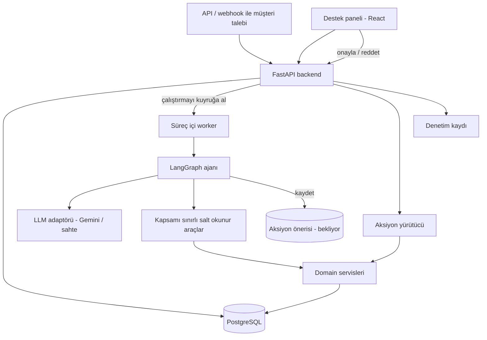
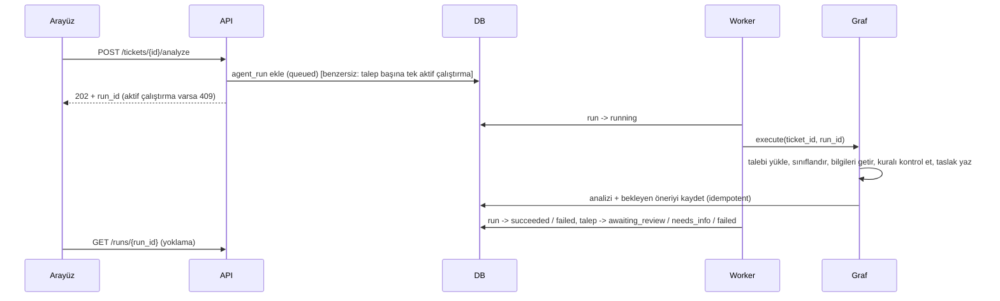
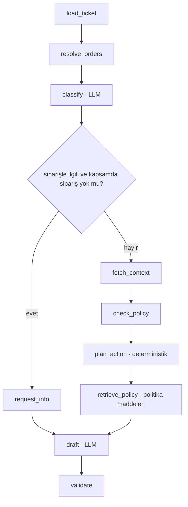
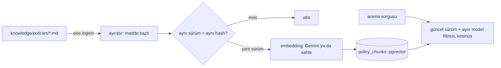

# Mimari

SupportFlow AI bir **modüler monolittir**: modülleri sıkı şekilde ayrılmış tek bir FastAPI backend'i, bir PostgreSQL veritabanı ve bir React paneli. Gerekçeler ve ödünleşimler [DECISIONS.md](DECISIONS.md) içinde.

## 1. Sisteme genel bakış



## 2. Backend modülleri ve bağımlılık kuralları

| Modül | Sorumluluk | Bağımlı olabileceği modüller |
|---|---|---|
| `api/` | Router'lar, kimlik doğrulama bağımlılıkları, istek/yanıt eşleme, HTTP hataları | `services`, `schemas`, `core` |
| `schemas/` | Pydantic API sözleşmeleri | — |
| `core/` | Ayarlar, kimlik doğrulama (JWT), loglama | — |
| `domain/` | Varlıklar, durum makineleri, kurallar, onaylayıcı rol kuralları | — (saf Python) |
| `services/` | Kullanım senaryoları: talepler, siparişler, çalıştırmalar, öneriler, aksiyon yürütücü, denetim | `domain`, `db`, `integrations` |
| `integrations/` | Mock sipariş/CRM veri erişimi; ileride MCP / n8n adaptörleri | `db` |
| `knowledge/policies/` (veri) | Sürümlü NovaShop politika dokümanları (markdown); `poe ingest` ile indekslenir | — |
| `agent/` | Graf durumu, düğümler, kenarlar, prompt'lar, araç sarmalayıcıları, LLM adaptörleri | `services` (salt okunur metotlar), `domain` |
| `db/` | SQLAlchemy modelleri, oturum, migration'lar | — |

Kesin kurallar:

- `domain/` ve `services/` LangGraph'ı, LLM SDK'sını ya da n8n'i asla import etmez. İş mantığı ajan olmadan test edilebilir.
- `agent/` aksiyon yürütücüyü asla import etmez. Ajanın tek yazma işlemi, öneri servisi üzerinden `pending` bir öneri kaydetmektir.
- İş kuralları route handler'larda ya da graf düğümlerinde değil, `domain/` ve `services/` içinde yaşar.

## 3. Temel akışlar

### 3.1 Talep analizi (arka plan çalıştırması)



- Uygulama açılırken hâlâ `running` olan çalıştırmalar `interrupted` gerekçesiyle `failed` olarak işaretlenir.
- Graf sınırları: azami adım, LLM zaman aşımı, artan beklemeyle yeniden deneme, çalıştırma başına token bütçesi.

### 3.2 Ajan grafiği (`app/agent/graph.py`, ADR-011)



| Düğüm | Ne yapar | Model? |
|---|---|---|
| `load_ticket` | Talebi yükler; araçları talebin müşterisine bağlar | hayır |
| `resolve_orders` | Müşterinin siparişleri + metinde geçen sipariş kimlikleri; başkasına ait ya da olmayan kimlikler `unknown_order_ids` olur | hayır |
| `classify` | Kategori, öncelik, atıf yapılan sipariş, istenen adres, injection işareti | evet |
| `request_info` | Kullanılabilir siparişi olmayan siparişle ilgili talep: siparişi sor | hayır |
| `fetch_context` | Müşterinin önceki talepleri (takip talepleri, S6) | hayır |
| `check_policy` | Kategorinin NovaShop kuralını kapsamdaki siparişe uygular | hayır |
| `plan_action` | `change_shipping_address` / `create_refund_request` aksiyonunu yalnızca kural izin veriyorsa önerir | hayır |
| `retrieve_policy` | Kural sonucunu açıklayan politika maddelerini arar (ADR-014). Hangi politikada aranacağına kural, arama metnine kuralın gerekçesi karar verir; müşteri metni kullanılmaz. Aksiyon planlandıktan sonra çalışır, kararı etkilemez. Arama başarısız olursa analiz uyarıyla sürer | hayır |
| `draft` | Bilgilerden, kural sonuçlarından ve planlanan aksiyondan özet ve yanıt | evet |
| `validate` | Doğrulanmamış kanıtları atar, `awaiting_review` mı `needs_info` mu olacağına karar verir, inceleme işaretini koyar | hayır |

Araçlar (izin listesi, salt okunur): talebin müşterisine bağlı `get_order`, `get_customer_orders`, `get_customer_tickets`, `get_policy`; ortak politika bilgi tabanını okuyan `search_policies`. Arama sorgusu adım kayıtlarına yazılmaz.

Destekleyici modüller: `prompts.py` (iki prompt; müşteri metni kapatamayacağı ayraç etiketleri içinde), `llm/` (sağlayıcı adaptörleri, sahte istemci, yeniden deneme), `tools.py`, `executor.py` (kuyruktaki bir çalıştırmayı yürütür; adımları `agent_run_steps` tablosuna kaydeder; başlamış bir çalıştırma her zaman `succeeded` ya da `failed` ile biter). Çalıştırma durum geçişleri, LLM'ler hakkında hiçbir şey bilmeyen `services/analysis_runs.py` içinde yaşar.

Önerilen aksiyon çalıştırma sonucunda ve aynı transaction içinde `pending` bir `ActionProposal` olarak saklanır (Faz 5).

### 3.3 Onay ve yürütme (ADR-012)

```mermaid
sequenceDiagram
    participant UI as Arayüz
    participant API
    participant Svc as ProposalService
    participant Orders as MockOrderSystem
    participant DB
    UI->>API: POST /proposals/{id}/decision (approve, expected_version)
    API->>Svc: decide(...)
    Svc->>DB: öneriyi kilitle; rol, sürüm, durum, son kullanma, içerik hash'i kontrolü
    Svc->>DB: approved -> executing + talep olayı + denetim (commit)
    Svc->>Orders: apply(idempotency_key = proposal-{id})
    Orders->>DB: anahtar görüldü mü? ilk sonucu döndür
    Orders->>DB: siparişi kilitle, kuralı yeniden kontrol et (TOCTOU), değişikliği uygula + action_executions satırı
    Svc->>DB: executed / failed + talep olayı + denetim (commit)
    API-->>UI: öneri (tekrarlanan istek 409 alır, asla ikinci bir etki olmaz)
```

- Öneriler çalıştırmayı tamamlayan transaction tarafından oluşturulur (çalıştırma başına bir, talep başına bir açık öneri); daha yeni bir analiz eski bekleyen önerilerin yerini alır.
- Onaylayıcı roller: adres değişikliklerini her personel rolü, iade taleplerini yalnızca `admin` onaylar (`app/domain/proposals.py`).
- Açılıştaki kurtarma, süresi geçmiş önerileri sonlandırır ve iki adım arasında yarıda kalan yürütmeleri tamamlar.
- `refund_requests` mock bir finans kaydıdır; para hareketi yoktur.

### 3.4 Politika bilgi tabanı (ADR-014)



- Ayrıştırma `app/domain/policy_documents.py` (saf), indeksleme ve arama `app/services/policy_knowledge.py`. Embedder dışarıdan verilir: `app/agent/llm/factory.py` → `GeminiEmbedder` ya da `FakeEmbedder`.
- Her indeksleme bir `ingestion_jobs` satırı yazar (durum, model, sayılar, hata).
- Dokümanlar karar vermez; kararlar `domain/policies.py`'de kalır. Graf, `retrieve_policy` düğümüyle bilgi tabanını okur; taslak yalnızca getirilen maddelere atıf yapabilir (`validate` diğerlerini atar ve uyarır).

## 4. Durum makineleri

**Talep** (`app/domain/ticket_status.py`): iki ayrı geçiş tablosu.

| Kaynak durum | Elle (personel, `PATCH /tickets/{id}` ile) | Sistem (yalnızca analiz akışı) |
|---|---|---|
| `new` | `resolved`, `needs_info` | `triaging` |
| `triaging` | yok | `awaiting_review`, `needs_info`, `failed` |
| `awaiting_review` | `resolved`, `needs_info` | yok |
| `needs_info` | `new` | yok |
| `failed` | `new` | yok |
| `resolved` | yok (son durum) | yok |

Personel bir yapay zekâ ön değerlendirme adımını taklit edemez, analiz akışı da bir talebi kendi başına çözemez. Geçersiz geçişler 409 döner. Her değişiklik `ticket_events` tablosuna eklenir.

**Aksiyon önerisi:** `pending → approved → executing → executed | failed`; `pending → rejected`; `pending → expired`. Her geçiş `version` değerini artırır.

**Ajan çalıştırması:** `queued → running → succeeded | failed`.

## 5. Güven sınırları

- LLM çıktısı güvenilmez bir öneridir. Bir Pydantic şemasıyla doğrulanır ve atıf yaptığı sipariş kimlikleri araçların gerçekten döndürdüğü verilerle karşılaştırılır.
- Talep metni, araç sonuçları ve (ileride) kural dokümanları ile webhook içerikleri talimat değil, veridir.
- Yetkilendirme her zaman sunucu tarafındadır. Arayüzde bir butonu gizlemek bir güvenlik önlemi değildir. Kullanıcının rolü her istekte veritabanından yeniden okunur; böylece pasifleştirme anında etkili olur.
- Bir müşteri için sipariş sorguları, başka müşterinin siparişini olmayan bir siparişle tamamen aynı şekilde bildiren `OrderService.get_customer_order` üzerinden yapılır.
- Loglar `correlation_id`, `ticket_id` ve `run_id` taşır; kişisel veriler maskelenir.

## 6. Frontend

React + TypeScript + Vite + React Router + TanStack Query; tasarım token'ları üzerine düz CSS ile stillendirilmiştir (ADR-013, `docs/DESIGN.md`). Sayfalar: genel bakış (role göre: sizin ya da bir yöneticinin kararını bekleyenler, yöneticiler için denetim kaydı), talepler, talep detayı (mesaj, yapay zekâ taslağı, graf adımlarıyla "bu öneri nasıl hazırlandı", öneri, sipariş, kural, geçmiş), onay kuyruğu. Tek bir API istemci katmanı; tipler backend OpenAPI şemasından üretilir. Yapay zekâ çıktısı her zaman taslak olarak etiketlenir.
