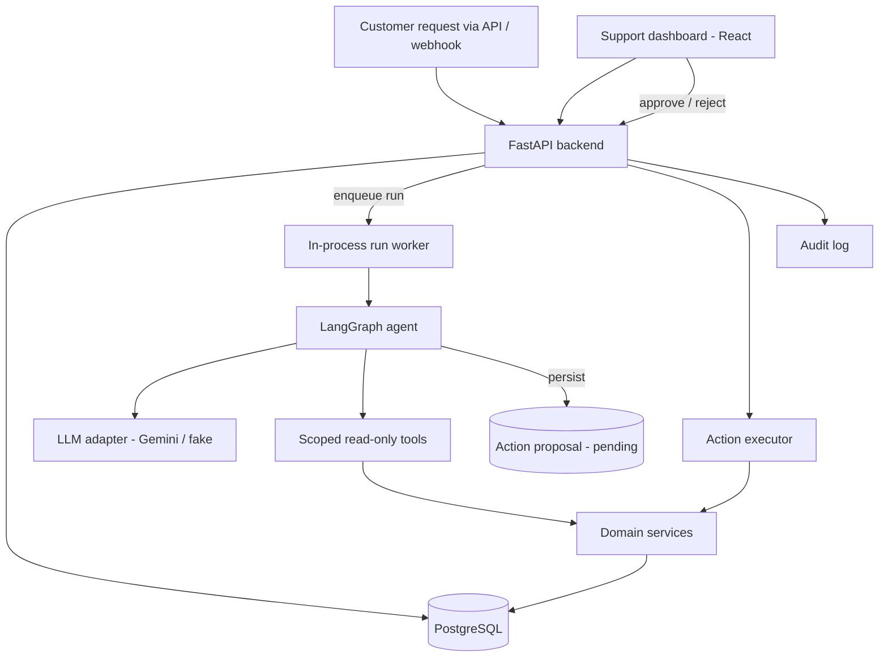
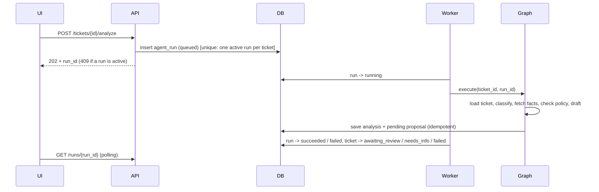
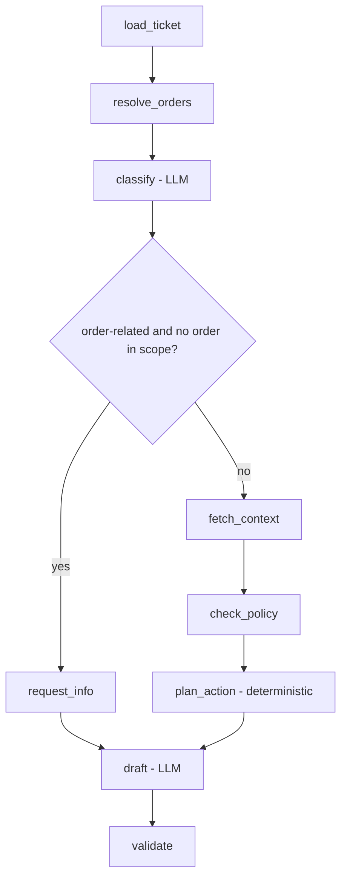
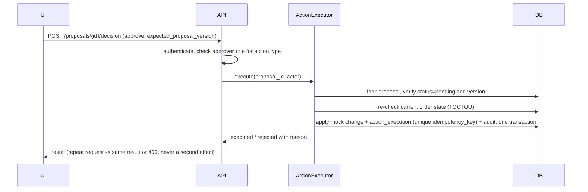

# Architecture

SupportFlow AI is a **modular monolith**: one FastAPI backend with strictly separated modules, a PostgreSQL database and a React dashboard. Rationale and trade-offs are in [DECISIONS.md](DECISIONS.md).

## 1. System overview

## 2. Backend modules and dependency rules

| Module | Responsibility | May depend on |
|---|---|---|
| `api/` | Routers, auth dependencies, request/response mapping, HTTP errors | `services`, `schemas`, `core` |
| `schemas/` | Pydantic API contracts | — |
| `core/` | Settings, auth (JWT), logging | — |
| `domain/` | Entities, status machines, policy rules, approver-role rules | — (pure Python) |
| `services/` | Use cases: tickets, orders, runs, proposals, action executor, audit | `domain`, `db`, `integrations` |
| `integrations/` | Mock order/CRM data access; later MCP / n8n adapters | `db` |
| `agent/` | Graph state, nodes, edges, prompts, tool wrappers, LLM adapters | `services` (read-only methods), `domain` |
| `db/` | SQLAlchemy models, session, migrations | — |

Hard rules:

- `domain/` and `services/` never import LangGraph, the LLM SDK or n8n. Business logic is testable without the agent.
- `agent/` never imports the action executor. The agent's only write is persisting a `pending` proposal through the proposal service.
- Business rules live in `domain/` and `services/`, never in route handlers or graph nodes.

## 3. Key flows

### 3.1 Ticket analysis (background run)

- On startup, runs still `running` are marked `failed` with reason `interrupted`.
- Graph limits: max steps, LLM timeout, retry with backoff, token budget per run.

### 3.2 Agent graph (`app/agent/graph.py`, ADR-011)

| Node | Does | Model? |
|---|---|---|
| `load_ticket` | Loads the ticket; binds the tools to its customer | no |
| `resolve_orders` | Customer's orders + order IDs mentioned in the text; foreign or missing IDs become `unknown_order_ids` | no |
| `classify` | Category, priority, referenced order, requested address, injection flag | yes |
| `request_info` | Order-related request without a usable order: ask for it | no |
| `fetch_context` | Customer's previous tickets (follow-ups, S6) | no |
| `check_policy` | Applies the category's NovaShop rule to the order in scope | no |
| `plan_action` | Proposes `change_shipping_address` / `create_refund_request` only if policy allows | no |
| `draft` | Summary and reply from the facts, policy results and planned action | yes |
| `validate` | Drops unverified evidence, decides `awaiting_review` vs `needs_info`, sets review flag | no |

Tools (allowlist, read-only, bound to the ticket's customer): `get_order`, `get_customer_orders`, `get_customer_tickets`, `get_policy`.

Supporting modules: `prompts.py` (two prompts; customer text inside delimiter tags it cannot close), `llm/` (provider adapters, fake client, retry), `tools.py`, `executor.py` (runs a queued run; records steps in `agent_run_steps`; a started run always ends `succeeded` or `failed`). Run state transitions live in `services/analysis_runs.py`, which knows nothing about LLMs.

The proposed action is part of the stored result. Persisting it as an `ActionProposal` and the approval flow are Phase 5.

### 3.3 Approval and execution

- Pending approvals live in `action_proposals`, so they survive restarts. No graph state is involved after the run ends.
- Expired proposals are never executed.

## 4. Status machines

**Ticket** (`app/domain/ticket_status.py`): two separate transition tables.

| From | Manual (staff via `PATCH /tickets/{id}`) | System (analysis pipeline only) |
|---|---|---|
| `new` | `resolved`, `needs_info` | `triaging` |
| `triaging` | none | `awaiting_review`, `needs_info`, `failed` |
| `awaiting_review` | `resolved`, `needs_info` | none |
| `needs_info` | `new` | none |
| `failed` | `new` | none |
| `resolved` | none (terminal) | none |

Staff cannot fake an AI triage step, and the pipeline cannot resolve a ticket on its own. Invalid transitions return 409. Every change is appended to `ticket_events`.

**Action proposal:** `pending → approved → executing → executed | failed`; `pending → rejected`; `pending → expired`.

**Agent run:** `queued → running → succeeded | failed`.

## 5. Trust boundaries

- LLM output is an untrusted suggestion. It is validated against a Pydantic schema, and any order IDs it cites are checked against data the tools actually returned.
- Ticket text, tool results and (later) policy documents and webhook payloads are data, never instructions.
- Authorization is always server-side. Hiding a button in the UI is not a control. The user's role is re-read from the database on every request, so deactivation takes effect immediately.
- Order lookups for a customer go through `OrderService.get_customer_order`, which reports another customer's order exactly like a missing one.
- Logs carry `correlation_id`, `ticket_id` and `run_id`, with PII redacted.

## 6. Frontend

React + TypeScript + Vite + Tailwind. Pages: dashboard, tickets, ticket detail (message, order facts, AI summary, proposal, evidence, timeline), approval queue, simple run view. A single API client layer; types generated from the backend OpenAPI schema where practical. AI output is always labeled as a suggestion.
